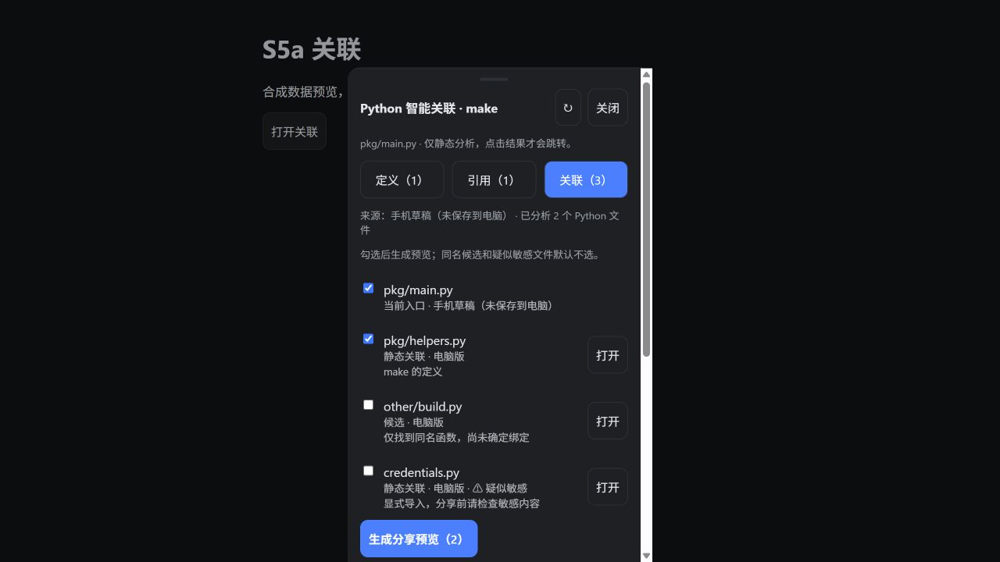
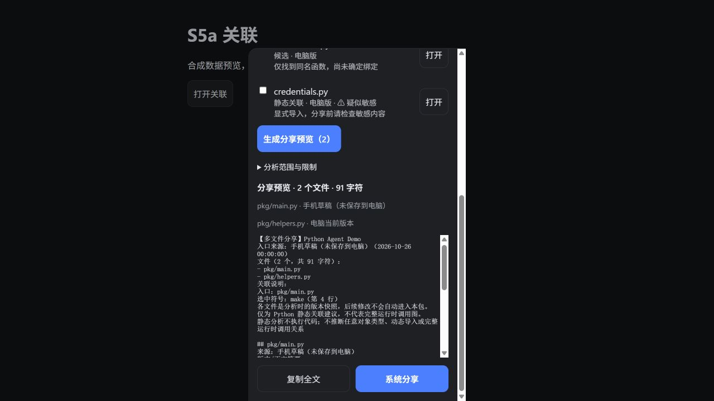

# S5a：Python 智能关联

交付日期：2026-10-26。版本：`S5a · build 2026-10-26-2`，
Android versionCode `10` / versionName `1.0-s5a1`。

## 已实现

- 在线打开 `.py` 文件后，可以看跨文件定义、引用和关联文件建议。
  识别函数、类、方法、相对导入、导入别名和有限重导出；支持常见 `src/` 布局
  及带 `__init__.py` 的嵌套子项目。注释、字符串不会当作语义引用。
- 无法确认的同名符号显示“同名候选”，不会自动跳转。模块名歧义、参数遮蔽、
  未知对象方法和动态返回值不会被当成确定绑定。
- 可以分析尚未保存到电脑的手机草稿。结果注明入口来自电脑、缓存还是草稿；
  其他文件使用电脑版本，不擅自混入其他文件的手机草稿。
- 点击结果跨文件跳转前保存本地草稿，返回历史最多保留 20 个文件。
  返回原文件恢复阅读位置或编辑模式与草稿；不承诺精确恢复编辑光标和选区。
- 关联文件可勾选、生成预览、复制全文或打开系统分享。文本包保留相对路径、
  来源、版本摘要与关联原因；候选和疑似敏感文件默认不勾选。
  分析后电脑文件若变化，会要求重新分析，避免把旧位置/旧关联与新正文混在一起。

## 使用入口

1. 安装 `mobile/android/app/build/outputs/apk/debug/app-debug.apk`；电脑端从托盘退出
   再重新启动，以加载新增接口。不需要重新配对。
2. 阅读 Python 文件：点“智能关联”；全屏时在操作栏中点“关联”。
   长按符号可进入“跳转定义”“查找引用”“关联分享”。
3. 编辑 Python 草稿：点“关联草稿”；把光标放到符号旁再点“代码操作”，
   可从当前草稿查看该符号的定义/引用。分析本身不保存到电脑。
4. 在“关联”标签核对文件清单，生成预览后再复制或系统分享。

本次按用户意愿不安排手动测试清单；后续日常使用发现问题再补。

## 实现位置

| 层 | 文件 | 作用 |
|---|---|---|
| 后端 | `desktop/pocketcode/services/python_context.py` | 标准库 AST 索引、词法/导入绑定、候选、预算 |
| API | `desktop/pocketcode/server/routes/projects.py`、`schemas.py` | 只读分析路由与类型 |
| 合同 | `contracts/openapi.yaml`、`errors.md`、`fixtures/python_context_*.json` | 字段、状态码、样例 |
| 手机 | `mobile/src/features/related/` | 结果抽屉、版本复核、带来源的分享包 |
| 导航 | `FileScreen.tsx`、`App.tsx`、`CodeEditor.tsx` | 主动触发、草稿、光标符号与返回历史 |

新增接口：`POST /v1/projects/{project_id}/python/context`。沿用现有鉴权与项目授权，
不运行代码、不 import 项目模块、不调用模型，无新增依赖。设计见
[ADR-0006](decisions/ADR-0006-python-static-context.md)。

## 已验证

| 检查 | 结果 |
|---|---|
| `.venv/Scripts/python.exe -m pytest desktop/tests` | 168 通过，1 跳过（系统不允许创建符号链接）；junction 用例通过 |
| `npm run typecheck` | 通过 |
| `npm test` | 82 通过，覆盖 API 请求、草稿分析、版本变化拒绝分享/跳转、返回历史和跳行优先级等 |
| `.venv/Scripts/python.exe integration-tests/contract/check_contracts.py` | 31 通过，15 个合同路径，17 条已实现路由，均在合同内 |
| 新服务及测试 `pyflakes` / `git diff --check` | 通过 |
| 浏览器预览 | 合成数据，390px 面板宽度；检查定义、引用、候选/敏感默认不选、分享预览布局 |
| `npm run build`、`npx cap sync android` | 通过 |
| `gradle --offline :app:assembleDebug --no-daemon --console=plain` | 通过，产物约 27.2 MiB |
| APK 内容核对 | 包含新版本标识、Python 关联界面与 API 路径，无临时预览页面 |

以上不是 Android 真机验收。手机测试使用模拟 API / hook 环境，不等于实际触摸、
Android 返回键、系统分享和设备升级持久化已经验证。
构建仍有现有的 Vite 大 chunk 和 Gradle 弃用提示；本次构建成功。

浏览器截图（合成示例，非真机）：

## 当前边界

- 仅 Python；其他语言沿用本文件的大纲和查找。新的项目级语义关联需要连接电脑。
- 静态建议不是完整调用图；不推断任意对象类型、动态导入、运行时路径或所有 Python 语法关系。
  引用结果是本次扫描中识别的使用位置，不包含全部可能引用。
- 单次最多 500 个 Python 文件、10,000 个目录条目、单文件 1 MiB、累计 8 MiB，
  尽力按约 3 秒预算停止，超限明确提示范围不完整；不是可抢占的严格响应时限。
  最多返回 30 个定义、100 个引用、20 个关联文件。
- 分享正文最多 20 万字符，界面仅显示前 8000 字符预览；复制/分享使用全文。
  每个文件是版本快照，不代表整个项目在同一瞬间的原子快照。
- S5b 补丁导入、ChatGPT 直连均尚未实现。
