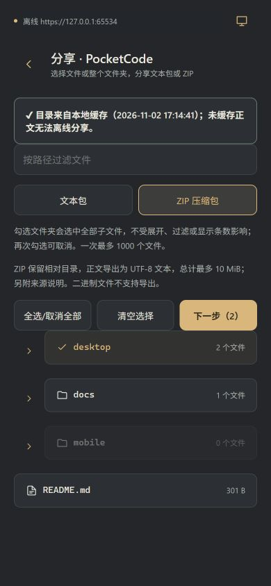
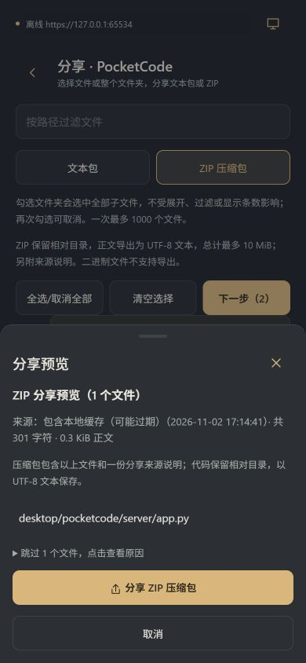

# ZIP 分享与文件夹整组选中

版本 `1.0-nightfall5` / versionCode `15`，`夜航 · build 2026-11-03-1`。

## 使用

在项目目录的「文件操作 → 多文件分享」里选择「文本包」或「ZIP 压缩包」。点击文件夹行即可递归选择其中全部文件；左侧箭头控制展开，展开状态和搜索过滤不会缩小文件夹的选择范围。部分文件已选中时，父目录显示「部分选中」，再次点击会补齐该目录，全部选中后再点则取消。

「全选/取消全部」作用于项目全部文件；输入过滤条件后，「全选/取消筛选结果」作用于所有匹配文件。渲染上限 400 项只影响显示，不影响批量选择。

下一步先读取正文并预览，再由用户点击分享。已有文本包和复制全文仍保留；ZIP 保留相对目录，用 UTF-8 导出文本正文，支持中文路径和空文件。另附唯一命名的 `PocketCode-分享说明.json`，记录各文件的电脑/缓存来源、版本与时间、跳过项，不写电脑绝对路径或设备令牌，也不覆盖用户同名文件。

这是可读文本导出，不是原始字节备份，不支持二进制文件。每次最多 1000 个所选文件；文本包正文最多 20 万字符，ZIP 正文最多 10 MiB。超额、二进制、缺缓存等逐项列出原因，不截断单个文件正文。在线遇到断线后，后续文件直接读缓存以免重复等待超时；授权/路径安全错误不回退缓存分享。准备时可以停止，取消和失败可保留预览重试。

## Android 与浏览器

- Android：fflate 生成真实 DEFLATE ZIP，原生桥仅接收有界 ZIP 数据，写入 `cache/pocketcode-share/`，经现有 `@capacitor/share` 与 FileProvider 分享文件 URI。无需增加公共存储权限，也不写入公共下载目录。
- 分享临时文件使用随机文件名，避免并发覆盖；生成下一个 ZIP 时清理超过 24 小时的自有旧 ZIP，不在分享结束后立即删除，以免目标应用还未读取。原生 ZIP 总文件上限 16 MiB，包含元数据与文件头开销。
- 浏览器：支持文件分享时使用 Web Share；不支持或分享能力受限时下载 ZIP。用户取消文件分享不会回退到下载；Android 失败不会把 ZIP 错当文本复制。
- 新增依赖 fflate 0.8.3，MIT；未修改电脑接口、草稿存储或原有本机配对数据。

## 验证

- 手机端 23 个测试文件、167 项通过。新测试覆盖递归选择/兄弟目录边界/部分选中/过滤/400 项显示上限、两种格式独立大小限制、在线/缓存来源、授权错误、取消准备、ZIP 路径校验与同名说明文件处理、中文路径/空文件解压、实际压缩、文件 URI/base64 字节、取消/失败/浏览器下载回退与文本包回归。
- App JVM 测试 `gradle :app:testDebugUnitTest --offline --no-daemon`：5 项通过，包含 2 项新 ZIP 缓存测试，验证可解压字节、中文目录、路径隔离、并发不覆盖、仅清理过期自有文件及无效输入拒绝。根 `testDebugUnitTest` 会额外运行第三方库测试，因离线未缓存其 Mockito/JSON 依赖失败；改用 App 精确任务通过。
- TypeScript 检查通过。
- Vite 正式构建、Capacitor 同步及 Android 离线构建通过；APK 内 127 项网页资源逐项与 dist 哈希一致，包含 fflate MIT 许可证，DEX 中确认有新的 ZIP 原生桥接方法。元数据为 versionCode 15 / `1.0-nightfall5`。
- 使用隔离 `127.0.0.1:5175/ui-fixture.html` 的假配对与缓存，在 390×844 浏览器检查了收起目录整组选中、筛选自动展开、部分选中、ZIP 预览和离线跳过说明。没有读取真实用户项目数据。
- 浏览器下载自动化等待回执超时，未把真实浏览器 ZIP 下载完成计为通过；下载/分享逻辑有单元测试。没有安装或验收 Android 真机，真实目标 App 接收 ZIP 的表现仍待实际使用验证。

截图是正式组件配合假缓存的浏览器画面：

## 主要文件与构建

- `mobile/src/features/sharing/{ShareScreen,selection,prepareBundle,archive,share,bundle}`：选择、准备、压缩及分享。
- `PocketCodeBridgePlugin.java`、`ShareArchiveStore.java` 与 `native/index.ts`：私有缓存写入桥。
- 图标、夜航样式、依赖锁文件、版本及相关测试同步更新。

在 `mobile` 执行 `npm test`、`npm run build`、`npm run cap:sync`；在 `mobile/android` 执行 `gradle assembleDebug --offline --no-daemon`。APK 为 `mobile/android/app/build/outputs/apk/debug/app-debug.apk`，需要覆盖安装完整 APK 以包含新的原生桥接方法。
